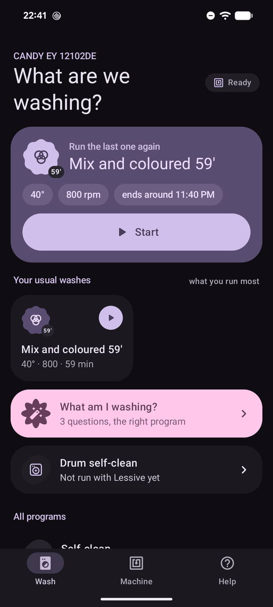
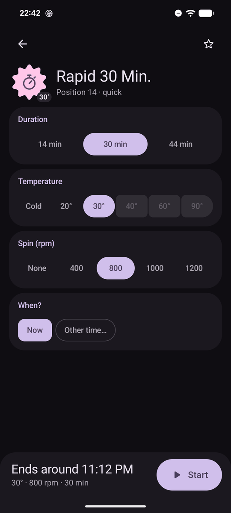
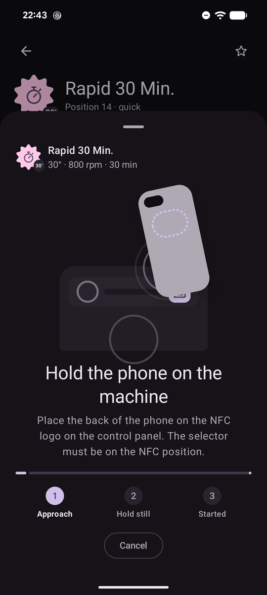
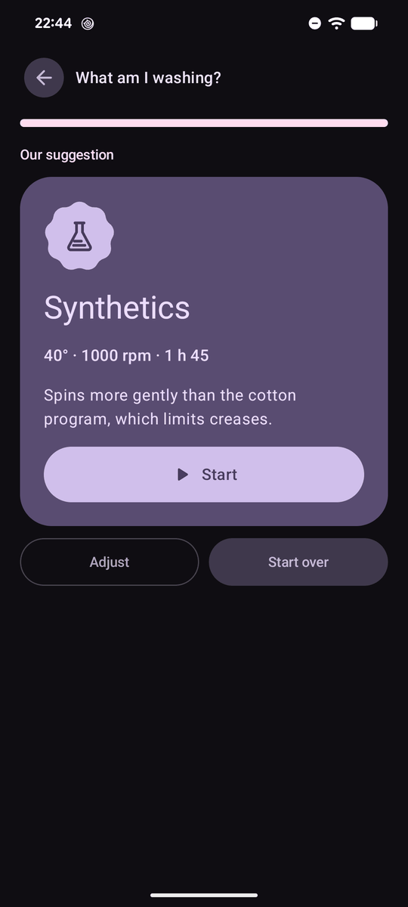
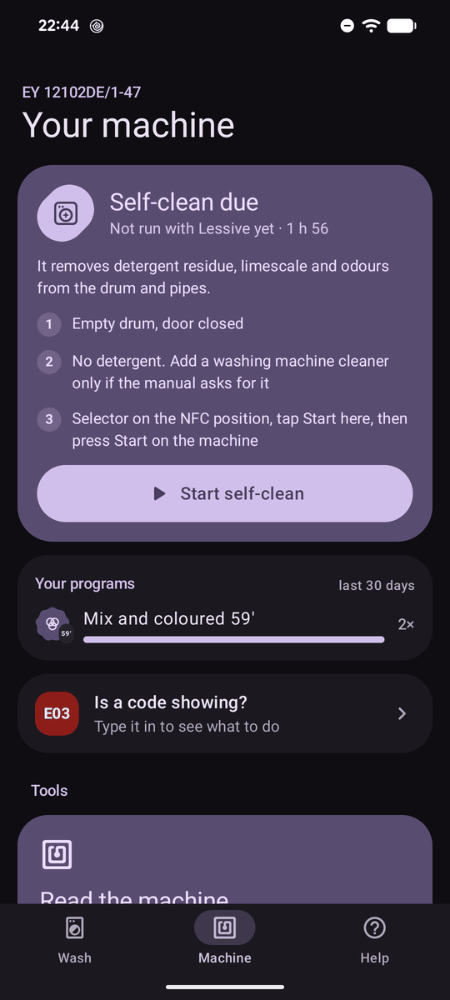
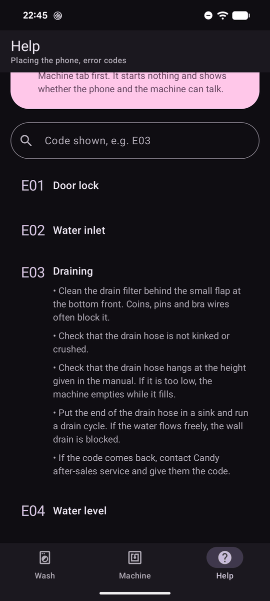

# Lessive

Lessive is an Android app (Kotlin, Jetpack Compose, Material 3 Expressive) that starts a
wash on an NFC-enabled Candy washing machine. You pick the program in the app, then hold
the phone against the NFC logo on the machine.

It was tested on a Candy EY 12102DE. Other models in the range use the same chip and
should work, with no guarantee.

The app is available in English, French and Polish.

## Screenshots

| Home | Program settings | Holding the phone |
|---|---|---|
|  |  |  |

| Program suggestion | Machine | Error codes |
|---|---|---|
|  |  |  |

## Where the protocol comes from

Most of the NFC protocol comes from the work of [@Gonvar](https://github.com/Gonvar),
published in [candy-csw-nfc](https://github.com/Gonvar/candy-csw-nfc) under the MIT
license. That repository documents the ST M24SR chip, the write password, the command
format, the CRC and the GPO handshake that makes the machine start. The CSW 475D/5-S dial
offered in the dial editor also comes from those measurements. The license is copied in
[`licenses/candy-csw-nfc.txt`](licenses/candy-csw-nfc.txt).

Lessive adds the reconnection the EY 12102DE needs. On that model, the machine drops the
NFC session right after the GPO signal, and its answer is read after reconnecting.

## Layout

- `protocol/` holds the protocol in plain Kotlin, with no Android dependency: CRC, start
  command, M24SR APDU sequence and status file parsing. Tests run against a chip
  simulator (`FakeM24sr`) and against a command validated on a real machine.
- `app/` holds the Compose application.

The app accepts an optional `datapack/` module that provides official program names and
machine definitions. It is not part of this repository. Without it, the app builds and
works, and dial positions are named in the dial editor. The error code help is written
for this app and does not need the module.

## Build and install

```sh
./gradlew :protocol:test          # protocol tests
./gradlew :app:assembleRelease    # app/build/outputs/apk/release/app-release.apk
adb install -r app/build/outputs/apk/release/app-release.apk
```

## Precautions

- The first thing to try is "Read the machine", in the Machine tab. It only reads and
  starts nothing.
- If the chip refuses the write password, the app blocks further sends. Each refusal uses
  up one attempt, and the chip can permanently lock the command file.
- The app does not implement the factory test cycle or EEPROM writes.
- Delayed start is counted in half hours. It has not been checked on a machine yet.

## License and trademarks

Lessive is not affiliated with or endorsed by Candy or Haier. Candy is a trademark of its
owner. The name appears here only to say which machines are supported.
